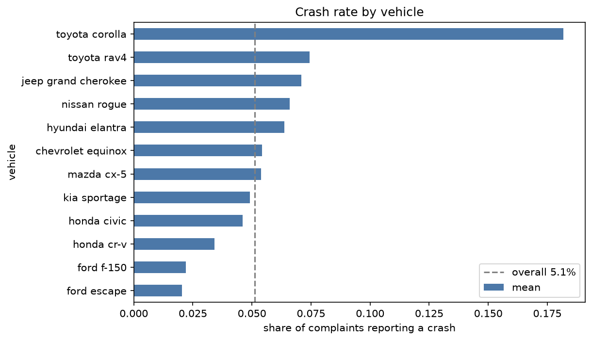
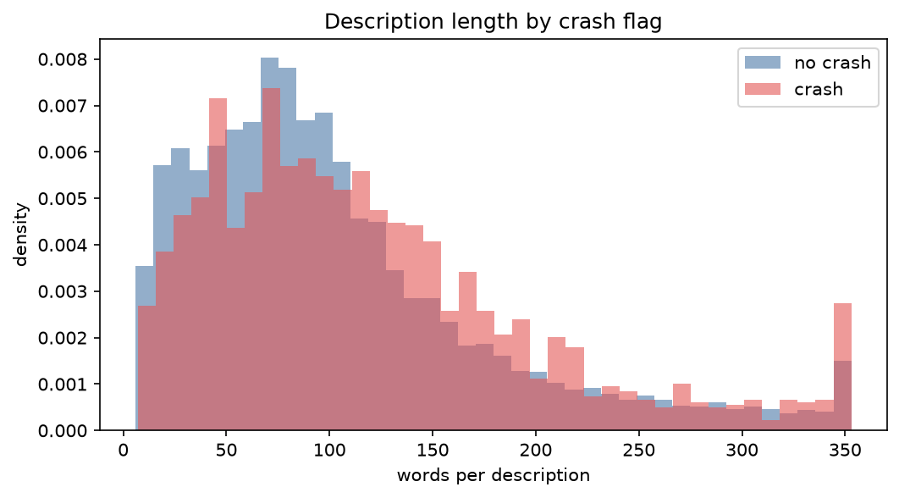

# Auto Claims: Text and Photo Classifiers

Two small, explainable models for car insurance claims intake, built on public data:

1. **NLP:** reads a driver's free-text description of a vehicle problem and flags whether it
   describes a **crash** (TF-IDF + logistic regression).
2. **Computer vision:** classifies **damage severity** (minor / moderate / severe) from a car photo,
   using a pretrained ResNet18 as a feature extractor + logistic regression.

> Sections between `AUTO` markers are regenerated from the latest run (`python -m src.update_readme`).
> Write your own comments outside them.

## Data exploration
<!-- AUTO:eda:start -->
| | |
|---|---|
| Complaints | 40,458 |
| Crash rate | 5.1% |
| Accuracy of always predicting "no crash" | 94.9% |
| Median words (crash / no crash) | 103 / 86 |
| Duplicate descriptions | 252 |

- **Imbalance:** only 5.1% of complaints report a crash, so a model that always says "no crash" is already 94.9% accurate. I evaluate with ROC-AUC, precision and recall on the crash class instead.
- **Length:** Crash descriptions are longer (median 103 vs 86 words), so length alone carries some signal.
- **Words typical of crash complaints** (share of crash vs no-crash descriptions): **pole** (4.5% vs 0.0%), **sternum** (1.2% vs 0.0%), **ambulance** (3.0% vs 0.0%), **bruises** (2.0% vs 0.0%), **bruising** (2.0% vs 0.0%).
- **Words typical of non-crash complaints:** **overheating**, **turbo**, **quoted**, **creating**, **timing**.
- **Leakage check:** "crash" in 31.1% of crash vs 2.1% of no-crash; "accident" in 23.5% of crash vs 5.9% of no-crash; "collision" in 16.2% of crash vs 3.8% of no-crash; "airbag" in 23.8% of crash vs 1.5% of no-crash. These are words drivers use to describe what happened, not a copy of the label field.




_Auto-generated from `reports/eda/eda_summary.json` on 2026-11-01._
<!-- AUTO:eda:end -->

**My notes on the exploration:** <your interpretation: what surprised you, what it means for the model>

## Results (held-out test data)
<!-- AUTO:results:start -->
| Model | Data | Result | Simple baseline |
|---|---|---|---|
| Crash flag from text | _run `python -m src.pipeline.run`_ | | |
| Severity from photo | _run `python -m src.image_model`_ | | |


_Auto-generated from `reports/` on 2026-11-01._
<!-- AUTO:results:end -->

## Text pipeline
`python -m src.pipeline.run` runs these steps from one config file (`configs/text_crash.yaml`):

load → validate & clean (drop short and duplicate texts) → stratified train/test split →
TF-IDF + logistic regression in one scikit-learn `Pipeline` → grid search with 5-fold
stratified cross-validation on the training set only → evaluation on the untouched test set
(ROC-AUC, average precision, precision/recall, threshold table, majority-class baseline) →
top words from the coefficients → everything saved in `runs/<name>_<timestamp>/`
(model, metrics, config copy, log, figures, errors to review) → README results refreshed.

## Why these choices
- **Logistic regression for both:** fast, and every prediction can be explained (word weights for
  text). Same family as the GLMs used in insurance pricing.
- **Pretrained ResNet18, not retrained:** with a few thousand photos, reusing a network trained on
  millions of images works better than training one from scratch, and runs on a laptop CPU.
- **class_weight="balanced":** crashes are a minority of complaints; this stops the model from
  ignoring them.

## What I learned
- <which complaints the text model gets wrong and why (see runs/<latest>/errors_to_review.csv)>
- <which severity classes get confused and why (they're subjective; minor vs moderate overlap)>

## Data
- **Text:** [NHTSA vehicle complaints API](https://api.nhtsa.gov/complaints/complaintsByVehicle)
  (US government, public domain): driver descriptions and the crash yes/no field, for 12 popular
  vehicles, model years 2015-2022.
- **Photos:** Roboflow Universe [car_damage_severity](https://universe.roboflow.com/pob/car_damage_severity-cnfnt)
  (CC0). Photos with several damage boxes take the label of the worst damage.

## Limitations
- NHTSA complaints are US defect reports, not insurance claims, and the crash field is filled in
  by the driver.
- Severity labels are subjective, and the photos are web images, not real claim photos.
- These are prototypes to support people, not to make claim decisions.

## Reproduce
```
py -m venv .venv
.venv\Scripts\Activate.ps1
pip install -r requirements.txt
python -m src.get_text_data     # downloads complaints (about 5 minutes)
python -m src.explore           # data exploration -> reports/eda/ + README
python -m src.pipeline.run --config configs/text_crash.yaml   # train + evaluate -> runs/ + README
python -m pytest -q             # tests
python -m src.image_model       # photos unzipped in data/photos/ (a few minutes on CPU) -> README
python -m src.predict --text "the brakes failed and I hit the car in front"
```
