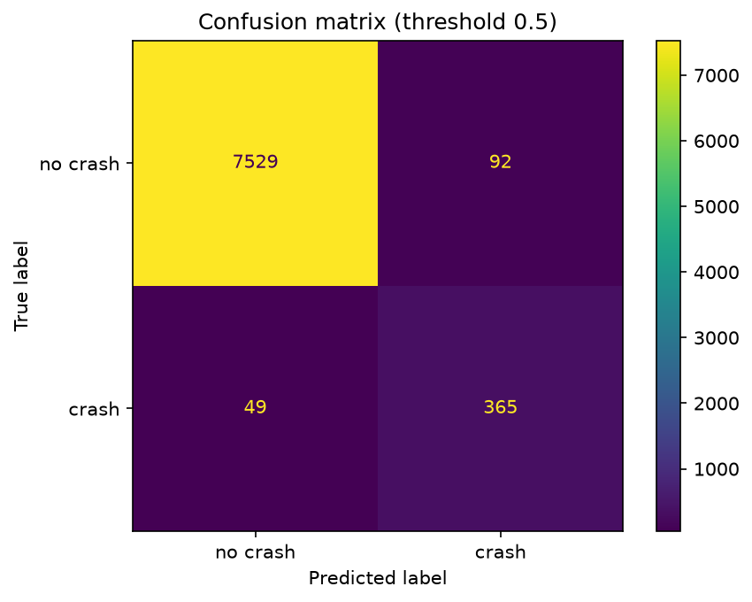
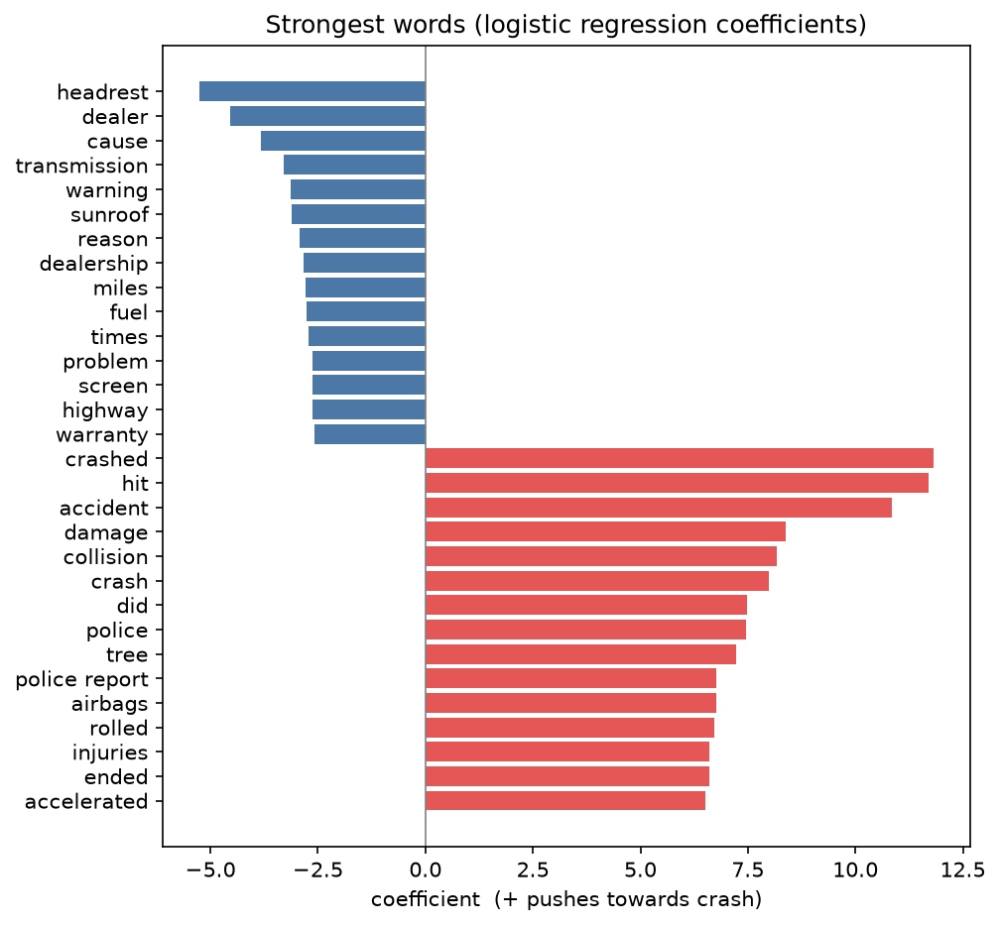
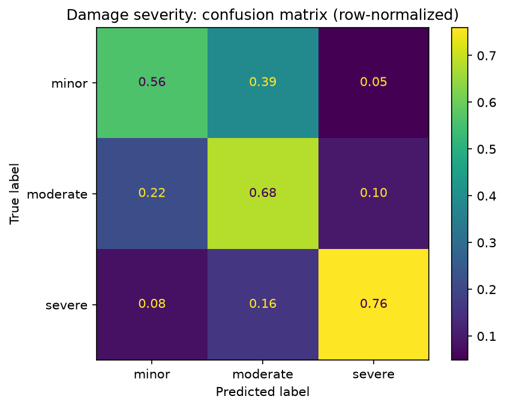

# Auto Claims: Text and Photo Classifiers

Two small, explainable models for car insurance claims intake, built on public data:

1. **NLP:** reads a driver's free-text description of a vehicle problem and flags whether it
   describes a **crash** (TF-IDF + logistic regression).
2. **Computer vision:** classifies **damage severity** (minor / moderate / severe) from a car photo,
   using a pretrained ResNet18 as a feature extractor + logistic regression.

> **TODO before publishing:** replace every `<...>` with your numbers from `reports/metrics.json`, then delete this note.

## Results (held-out test data)
| Model | Data | Result | Simple baseline |
|---|---|---|---|
| Crash flag from text | <N> NHTSA complaints | AUC <...>, recall on crash <...>, precision <...> | always "no crash": <...> accuracy |
| Severity from photo | <N> photos | accuracy <...>, macro-F1 <...> | always the most common class: <...> accuracy |





**Words that point to a crash:** <paste from reports/text_top_words.json>
**Words that point to no crash:** <paste>

## Text pipeline
`python -m src.pipeline.run` runs these steps from one config file (`configs/text_crash.yaml`):

load → validate & clean (drop short and duplicate texts) → stratified train/test split →
TF-IDF + logistic regression in one scikit-learn `Pipeline` → grid search with 5-fold
stratified cross-validation on the training set only → evaluation on the untouched test set
(ROC-AUC, average precision, precision/recall, threshold table, majority-class baseline) →
top words from the coefficients → everything saved in `runs/<name>_<timestamp>/`
(model, metrics, config copy, log, figures, errors to review).

## Why these choices
- **Logistic regression for both:** fast, and every prediction can be explained (word weights for
  text). Same family as the GLMs used in insurance pricing.
- **Pretrained ResNet18, not retrained:** with a few thousand photos, reusing a network trained on
  millions of images works better than training one from scratch, and runs on a laptop CPU.
- **class_weight="balanced":** crashes are a minority of complaints; this stops the model from
  ignoring them.

## What I learned
- <from exploration: crash rate, text length, strongest words, any data issues found>
- <2-3 bullets: e.g. which complaints the text model gets wrong (see runs/<latest>/errors_to_review.csv)>
- <which severity classes get confused and why (they're subjective; minor vs moderate overlap)>

## Data
- **Text:** [NHTSA vehicle complaints API](https://api.nhtsa.gov/complaints/complaintsByVehicle)
  (US government, public domain): driver descriptions and the crash yes/no field, for 12 popular
  vehicles, model years 2015-2022.
- **Photos:** Roboflow Universe [car_damage_severity](https://universe.roboflow.com/pob/car_damage_severity-cnfnt)
  (CC0). Photos with several damage boxes take the label of the worst damage.

## Limitations
- NHTSA complaints are US defect reports, not insurance claims, and the crash field is filled in
  by the driver.
- Severity labels are subjective, and the photos are web images, not real claim photos.
- These are prototypes to support people, not to make claim decisions.

## Reproduce
```
py -m venv .venv
.venv\Scripts\Activate.ps1
pip install -r requirements.txt
python -m src.get_text_data     # downloads complaints (about 5 minutes)
python -m src.explore           # data exploration -> reports/eda/
python -m src.pipeline.run --config configs/text_crash.yaml   # train + evaluate -> runs/
python -m pytest -q             # tests for the cleaning step
python -m src.image_model       # photos unzipped in data/photos/ (a few minutes on CPU)
python -m src.predict --text "the brakes failed and I hit the car in front"
```
