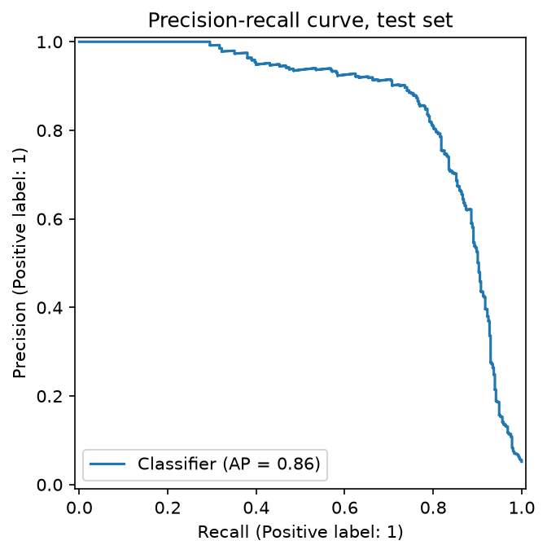
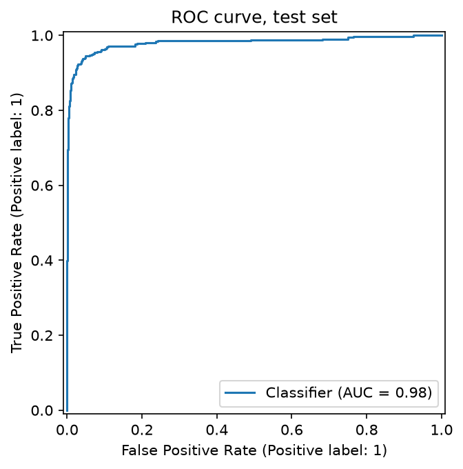
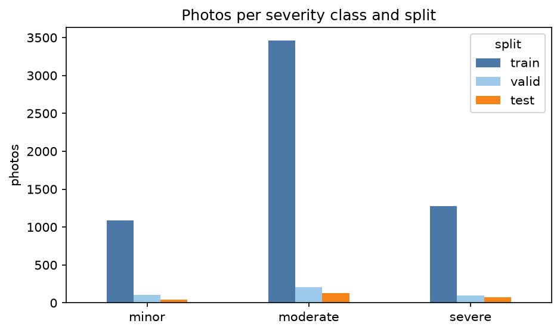
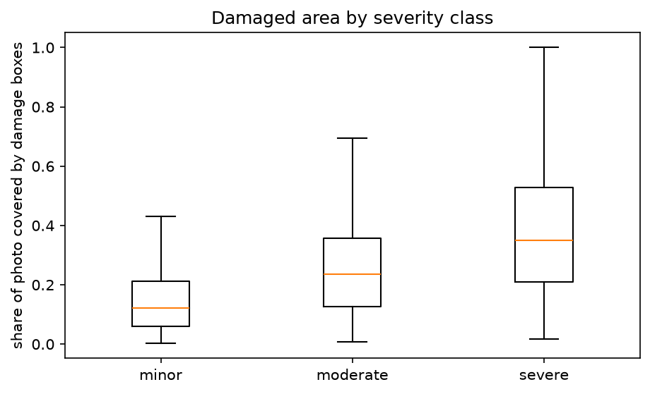
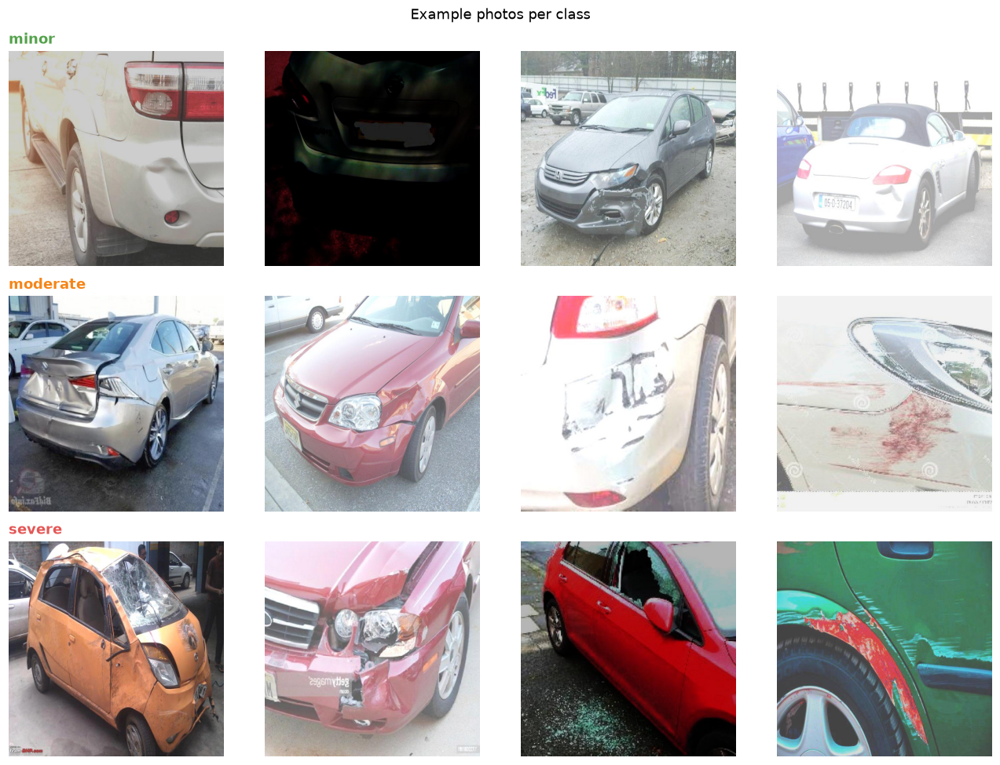
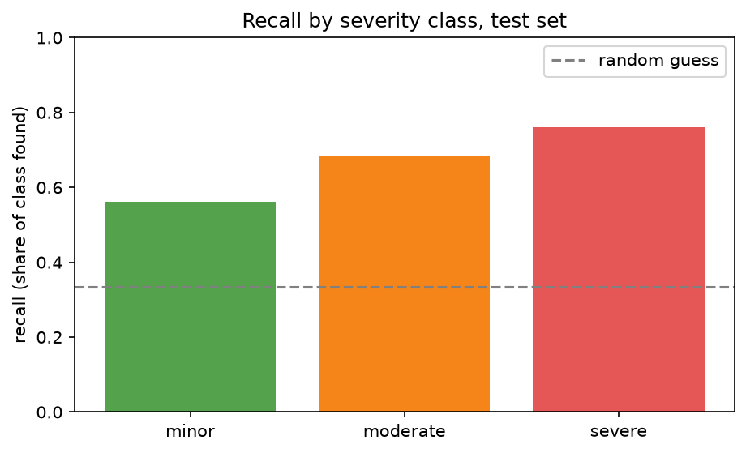
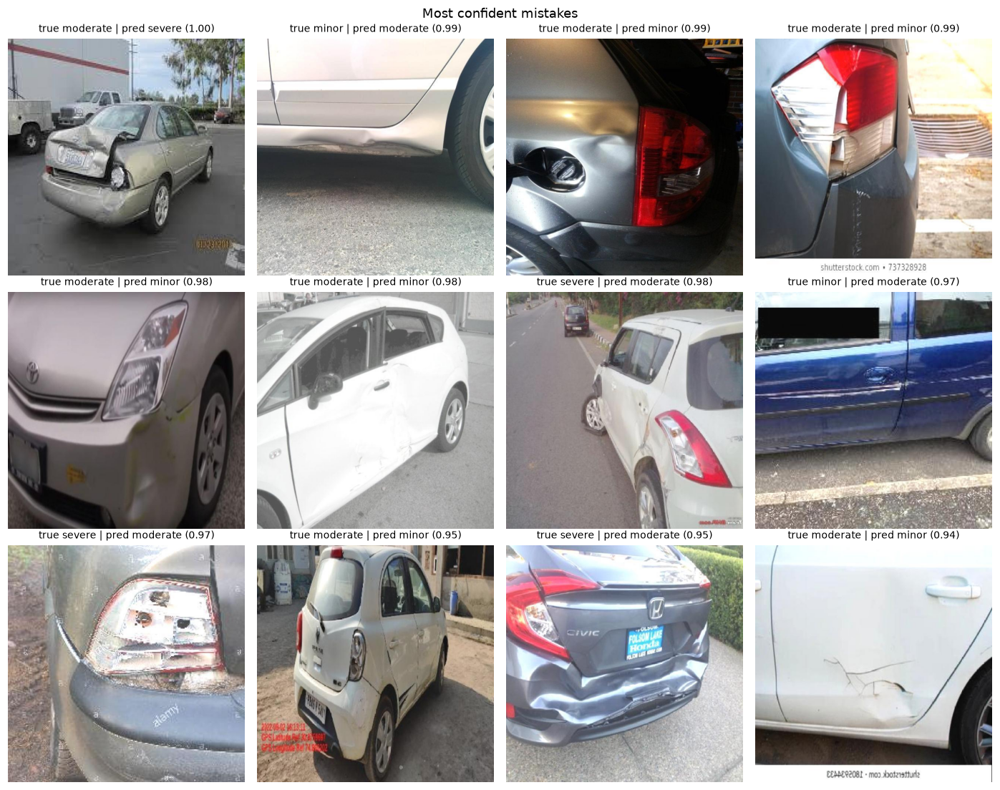

# Auto Claims: Text and Photo Classifiers

Two small, explainable models for car insurance claims intake, built on public data:

1. **NLP:** reads a driver's free-text description of a vehicle problem and flags whether it describes
   a **crash** (TF-IDF + logistic regression).
2. **Computer vision:** classifies **damage severity** (minor / moderate / severe) from a car photo, using an
   ImageNet-pretrained ResNet18 as a frozen feature extractor + logistic regression.

Both models end in a logistic regression on purpose: they are fast, their behaviour can be explained, and they give an honest baseline before trying anything heavier.

## Results at a glance
<!-- AUTO:summary:start -->
| Model | Data | Result | Simple baseline |
|---|---|---|---|
| Crash flag from text | 40,174 NHTSA complaints (8,035 in test) | ROC-AUC 0.981, recall 88.2%, precision 79.9% | always "no crash": 94.8% accuracy |
| Severity from photo | 6,477 photos (248 in test) | accuracy 68.5%, macro-F1 0.653 | most common class: 53.2% accuracy |

_Auto-generated from `reports/` on 2026-11-01._
<!-- AUTO:summary:end -->

**In one sentence each:**
- **Text:** the model ranks crash reports very well (ROC-AUC 0.98) and catches 88% of crashes while flagging
  under 6% of complaints. Many of its remaining "errors" turn out to be mislabelled complaints.
- **Photos:** the model clearly beats the baseline (macro-F1 0.65 vs 0.23), and 90% of its mistakes are off by
  only one severity level. The ceiling is set by the labels and the data, not the model: severity labels are
  ambiguous, and the training set appears to contain augmented copies of the same photos.

> Sections between `AUTO` markers are regenerated from the latest run. The analysis around them is written by
> hand and refers to the run of 2026-11-01.

---

## Part 1: Text: is this complaint about a crash?

### 1.1 Data
Driver complaints from the [NHTSA vehicle complaints API](https://api.nhtsa.gov/complaints/complaintsByVehicle)
(US government, public domain) for 12 popular vehicles, model years 2015-2022. Each complaint has a free-text
description and a yes/no **crash** field filled in by the driver; that field is the label.

### 1.2 Data exploration
<!-- AUTO:eda:start -->
| | |
|---|---|
| Complaints | 40,458 |
| Crash rate | 5.1% |
| Accuracy of always predicting "no crash" | 94.9% |
| Median words (crash / no crash) | 103 / 86 |
| Duplicate descriptions | 252 |

- **Imbalance:** only 5.1% of complaints report a crash, so a model that always says "no crash" is already 94.9% accurate. I evaluate with ROC-AUC, precision and recall on the crash class instead.
- **Length:** Crash descriptions are longer (median 103 vs 86 words), so length alone carries some signal.
- **Words typical of crash complaints** (share of crash vs no-crash descriptions): **pole** (4.5% vs 0.0%), **sternum** (1.2% vs 0.0%), **ambulance** (3.0% vs 0.0%), **bruises** (2.0% vs 0.0%), **bruising** (2.0% vs 0.0%).
- **Words typical of non-crash complaints:** **overheating**, **turbo**, **quoted**, **creating**, **timing**.
- **Leakage check:** "crash" in 31.1% of crash vs 2.1% of no-crash; "accident" in 23.5% of crash vs 5.9% of no-crash; "collision" in 16.2% of crash vs 3.8% of no-crash; "airbag" in 23.8% of crash vs 1.5% of no-crash. These are words drivers use to describe what happened, not a copy of the label field.


_Auto-generated from `reports/eda/eda_summary.json` on 2026-11-01._
<!-- AUTO:eda:end -->

**What the exploration tells us**

- **The problem is heavily imbalanced.** Only 5.1% of the 40,458 complaints report a crash. A model that never
  predicts a crash would be 94.9% accurate, so accuracy is useless here. I evaluate with ROC-AUC, average
  precision, and precision/recall on the crash class.
- **Crash descriptions are longer** (median 103 vs 86 words). Drivers who crashed describe the sequence of
  events, the damage and often the injuries. In the length chart, the crash distribution has a heavier right
  tail. The spike at about 350 words is not real: the chart caps lengths at the 99th percentile, so all longer
  descriptions pile up in the last bin.
- **Two different views of "typical words" agree on the story.** The exploration ranks words by how much more
  often they appear in crash complaints. It surfaces rare but very specific words: **pole** (4.5% of crash vs
  0.0% of non-crash descriptions), **ambulance** (3.0% vs 0.0%), **bruises/bruising** and **sternum** (seatbelt
  and airbag injuries). Non-crash complaints are about mechanical problems and repairs: **overheating, turbo,
  timing, quoted**. The model's coefficients (section 1.4) rank more frequent words instead; both point to the
  same separation between "something happened on the road" and "something is wrong with the car".
- **No leakage, but strong signal words.** "Crash" appears in 31.1% of crash descriptions vs 2.1% of the
  others, "airbag" in 23.8% vs 1.5%. These are words drivers naturally use, not a copy of the label. The
  check also shows the task is not trivial: "accident" appears in 5.9% of non-crash complaints (for example
  "this could cause an accident"), so the model must rely on context, not single keywords.
- **Crash rates differ a lot by vehicle.** The Toyota Corolla stands out at about 17% (three times the 5.1%
  average); the Ford Escape and F-150 are near 2%. This is worth investigating (a specific defect or recall
  campaign may drive it). It doesn't bias this model, which only reads the text, but it would matter if
  vehicle were added as a feature.
- **Data quality:** 252 duplicate descriptions (the same text filed under different complaint IDs) are
  removed before modelling; otherwise the same text could land in both the training and test sets.

### 1.3 Model and pipeline
`python -m src.pipeline.run` runs everything from one config file (`configs/text_crash.yaml`):

load → clean (drop short and duplicate texts: 40,458 → 40,174 complaints) → stratified 80/20 train/test split →
TF-IDF (words and word pairs) + class-weighted logistic regression in one scikit-learn `Pipeline` → grid search
with 5-fold stratified cross-validation on the training set only → one evaluation on the untouched test set →
everything saved in `runs/<name>_<timestamp>/` (model, metrics, config copy, log, charts, errors to review).

Because TF-IDF and the logistic regression are fitted together inside cross-validation, the vocabulary is learned
on training folds only, and no information from held-out complaints leaks into the model.

### 1.4 Results
<!-- AUTO:text_results:start -->
| Metric | Value |
|---|---|
| Test complaints | 8,035 (5.1% crashes) |
| ROC-AUC | 0.981 |
| Average precision (random = 0.051) | 0.901 |
| Precision / recall / F1 at 0.5 | 79.9% / 88.2% / 0.838 |
| Accuracy (always "no crash") | 98.2% (94.8%) |
| Cross-validated roc_auc (train) | 0.974 |

**Threshold trade-off:**

| Threshold | % flagged | Precision | Recall |
|---|---|---|---|
| 0.3 | 7.6% | 0.623 | 0.918 |
| 0.4 | 6.4% | 0.723 | 0.896 |
| 0.5 | 5.7% | 0.799 | 0.882 |
| 0.6 | 5.2% | 0.843 | 0.857 |
| 0.7 | 4.8% | 0.879 | 0.826 |

Best settings from cross-validation: `{'logreg__C': 3.0, 'tfidf__max_features': 100000, 'tfidf__ngram_range': [1, 2]}`.

**Words that point to a crash:** crashed, hit, accident, damage, collision, crash, did, police, tree, police report, airbags, rolled

**Words that point to no crash:** headrest, dealer, cause, transmission, warning, sunroof, reason, dealership, miles, fuel, times, problem






_Auto-generated from `reports/text_metrics.json` on 2026-11-01._
<!-- AUTO:text_results:end -->

**How good is it?**

- **Ranking is excellent:** ROC-AUC 0.981. A randomly chosen crash complaint scores higher than a randomly
  chosen non-crash complaint 98% of the time. The precision-recall curve stays above about 0.9 precision up to
  roughly 75% recall, then drops; that elbow is where the hard, ambiguous cases start.
- **At the default threshold (0.5):** of the 414 crashes in the test set, the model catches 365 (88.2% recall).
  It flags 457 complaints, of which 365 are real crashes (79.9% precision). Only 5.7% of all complaints are
  flagged.
- **No overfitting:** the cross-validated AUC on the training set (0.974) is in line with the test AUC (0.981).
- **Tuning helped precision:** widening the grid from 50,000 to 100,000 features raised precision from 76.4% to
  79.9% at the same recall. Both selected values (C = 3, 100,000 features) still sit at the edge of the grid,
  so the next run should try larger values.

**Choosing the threshold is a business decision**

Lowering the threshold from 0.5 to 0.3 raises recall from 88.2% to 91.8% (about 15 more crashes caught out of
414). The cost is flagging 7.6% of complaints instead of 5.7% (about 150 more to review). That's roughly
**10 extra reviews per extra crash caught**. For claims triage, where a missed serious claim is expensive,
0.3–0.4 is a reasonable choice. In practice the threshold should be set with the claims team, based on how
many files adjusters can review.

**What the model learned**

The strongest words are sensible and easy to defend: **crashed, hit, accident, damage, collision, crash,
police, police report, tree, rolled, airbags, injuries**. Words pointing away from a crash describe mechanical
problems and dealer visits: **headrest, dealer, dealership, transmission, sunroof, warning, fuel, screen,
warranty, miles**. Two less obvious ones:
- **"did"** pushes towards crash, most likely through "the air bags **did** not deploy", a phrase that only
  appears after an impact.
- **"accelerated"** reflects sudden-acceleration incidents, which often end in a collision.

**Error analysis: many errors are label problems, not model problems**

I read the 25 most confident errors of each type (`runs/<latest>/errors_to_review.csv`).

*False positives* (model says crash, label says no crash):
- **About 10 of 25 clearly describe a collision but are labelled "no crash"**: a car that drove into a house
  with the airbag deployed and a passenger injured, a car that rolled 3½ times and was totaled, a rear-end
  collision with a police report. The model is right; the label is wrong. NHTSA documents that since May 2021 a
  blank yes/no field is shown as "N", so a crash box the driver didn't tick becomes "no crash".
- **About 5 describe an airbag deploying without a real collision** (brushing a curb, hitting a pothole).
  These are genuinely ambiguous.
- **About 6 are near-misses** ("almost hit 5 cars", "nearly hit a tree"). A bag-of-words model can't fully
  separate "hit" from "almost hit".

*False negatives* (label says crash, model says no crash):
- **About 15 of 25 don't describe a crash at all** (a fuel pump, a transmission whine, a seat belt buckle).
  The crash may only have been reported in the form; no text model can recover it.
- **About 10 describe a crash in unusual wording** ("slammed into road railing", "I was t-boned") **or bury it
  in a very long description**, where one crash sentence carries little weight among many others.

**So the 79.9% precision is a pessimistic estimate:** part of the false positives are correct predictions on
mislabelled complaints. These counts come from the most confident errors, not a random sample; a proper estimate
of the label error rate would need a random sample to be relabelled by hand.

---

## Part 2: Photos: how severe is the damage?

### 2.1 Data
Roboflow Universe [car_damage_severity](https://universe.roboflow.com/pob/car_damage_severity-cnfnt) (CC0):
photos of damaged cars with boxes around each damaged area, labelled minor, moderate or severe. A photo can
contain several boxes, so each photo takes the label of its **most serious** damage (the one that would drive
the claim).

### 2.2 Data exploration
<!-- AUTO:image_eda:start -->
| Class | train | valid | test | Share | Median damages | Median damaged area |
|---|---|---|---|---|---|---|
| minor | 1,089 | 107 | 41 | 19.1% | 1 | 12.1% |
| moderate | 3,458 | 206 | 132 | 58.6% | 1 | 23.5% |
| severe | 1,274 | 95 | 75 | 22.3% | 1 | 35.1% |

- **6,477 photos** after validation. Majority class: **moderate** (58.6%), so always guessing it would be 58.6% accurate.
- **17.6% of photos contain more than one severity**; each photo takes its most serious damage as its label.
- **Data checks:** 0 photos without labels and 0 unreadable files removed; 2 duplicate files removed, 0 of which appeared in more than one split (kept only in the earliest split, so no test photo is also a training photo).
- **Photo size:** median 640 x 640 px, smallest side 640 px (photos are resized to 224 x 224 for ResNet18).





_Auto-generated from `reports/image_eda/eda_summary.json` on 2026-11-01._
<!-- AUTO:image_eda:end -->

**What the exploration tells us**

- **The classes are imbalanced towards "moderate"** (58.6% of photos). Always guessing "moderate" would be
  about 53% accurate on the test set, so macro-F1, which weights the three classes equally, is the main
  metric.
- **The splits are unusual: 90% of photos are in training** (5,821 train / 408 valid / 248 test). The public
  dataset page lists 2,598 original photos, while the version used to train its model has 6,482. That points
  to Roboflow **augmentation**: flipped, recoloured and rotated copies of training photos. The colour-shifted
  photos in the example grid support this. It matters for evaluation (see 2.4): copies of the same photo can
  land in different cross-validation folds. The test photos are not augmented, so the test score stays
  honest.
- **Labels are ambiguous, and some look wrong.** In the example grid, a car with a torn-off front bumper is
  labelled **minor**, a car with a heavily crushed rear is **moderate**, and a scraped wheel arch is
  **severe**. Severity was labelled per damaged area by different annotators without a visible rule, so the
  boundary between neighbouring classes is fuzzy.
- **Damaged area grows with severity, but the classes overlap heavily.** The median share of the photo covered
  by damage is 12% (minor), 24% (moderate) and 35% (severe), but the boxes in the chart overlap widely. Part of
  this is framing: a close-up of a small dent can fill most of the photo, while severe damage photographed from
  far away covers little. **Area in pixels is not area in reality.**
- **17.6% of photos contain more than one severity**, so the "worst damage" rule matters for those photos.
  Every class has a median of one damage per photo, so the number of damages doesn't separate them.
- **Data quality:** no unreadable or unlabelled files, and 2 exact duplicates removed. But the checks only
  catch byte-identical files: augmented copies and near-black photos (one appears in the example grid) pass
  through.
- **All photos are 640 × 640 px:** Roboflow resized them to a square, which stretches some cars. The model then
  resizes and centre-crops to 224 × 224, which cuts about 6% from each edge; damage near the border can be
  lost.

### 2.3 Model and pipeline
`python -m src.image_pipeline.run` runs everything from one config file (`configs/image_severity.yaml`):

load YOLO labels (one label per photo = its most serious damage) → validate (unlabelled, unreadable and
duplicate files) → explore → ResNet18 pretrained on ImageNet turns each photo into 512 features (frozen; cached
so re-runs are fast) → standardise + class-weighted logistic regression, tuned with stratified 5-fold
cross-validation on training photos → one evaluation on the test photos → everything saved in `runs/`.

The network is not retrained: with a few thousand photos, reusing features learned on millions of images is
more reliable than training a network from scratch, and it runs on a laptop CPU.

### 2.4 Results
<!-- AUTO:image_results:start -->
| Metric | Model | Majority-class baseline |
|---|---|---|
| Accuracy | 68.5% | 53.2% |
| Macro-F1 | 0.653 | 0.232 |

- **Test set:** 248 photos (`test` split); trained on 6,229.
- **Recall by class:** minor 56.1% · moderate 68.2% · severe 76.0%.
- **Size of mistakes:** 28.2% of test photos are off by one severity level, 3.2% by two (severe called minor: 6, minor called severe: 2).
- **Best setting from cross-validation:** `{'logreg__C': 0.1}` (CV f1_macro 0.762).





_Auto-generated from `reports/image_metrics.json` on 2026-11-01._
<!-- AUTO:image_results:end -->

**How good is it?**

- **Clearly better than guessing:** 68.5% accuracy vs 53.2% for always predicting "moderate", and macro-F1
  0.653 vs 0.232. The baseline's macro-F1 is so low because it never finds a minor or severe photo; the model
  finds all three classes.
- **Severe damage is the best-detected class** (76.0% recall, 57 of 75), then moderate (68.2%) and minor
  (56.1%). For triage this is the right way round: the costly mistake, severe damage called minor, happened
  only 6 times out of 75 severe photos (8%).
- **Almost all mistakes are small:** 28.2% of test photos are off by one level and only 3.2% by two. In other
  words, **90% of errors are between neighbouring classes**, which is exactly where the labels are most
  ambiguous. The confusion matrix shows the main leak: 39% of minor photos are called moderate.
- **The cross-validation score is too optimistic:** macro-F1 0.762 on training folds vs 0.653 on the test set.
  The most likely reason is the augmented copies described in 2.2: a flipped copy of a photo in one fold is
  "seen" while its original is evaluated in another fold. This doesn't change the test result, but it means
  the tuned value of C was chosen on an inflated score.

**Error analysis: what the most confident mistakes show**

- **Some errors are label problems.** The model's most confident mistake (probability 1.00) is a car with a
  crushed front corner, labelled *moderate* and predicted *severe*; most people would agree with the model. A
  Honda Civic with a pushed-in rear bumper is labelled *severe* and predicted *moderate*, which is also
  debatable.
- **Many errors are close-ups** of a tail light, a headlight, a fuel cap area or a door panel. Without the rest
  of the car in view, neither the model nor a person can judge how big the damage really is. ResNet features
  describe the whole image (what's in it, how it's framed) rather than measuring the damaged area itself.
- **Labels describe a damaged region, but the model sees the whole photo.** The boxes are labelled region by
  region, and I collapse them into one label per photo. A photo with a small severe box and a large undamaged
  car is hard for a whole-image model.

---

## What I would do next

**Text model**
1. Extend the grid (C up to 30, more features), since both best values sit at the edge.
2. Relabel a random sample of about 100 errors to measure label noise and build a cleaner test set.
3. Handle near-misses and negation ("almost hit", "did not crash"): try longer n-grams, then a fine-tuned
   transformer, compared against this baseline.
4. Check probability calibration, so a score of 0.8 really means about an 80% chance of a crash.

**Photo model**
1. **Remove augmentation leakage:** download the dataset version without augmentation, or group copies by their
   original file name (Roboflow names them `original_jpg.rf.<id>.jpg`) and use grouped cross-validation.
2. **Classify the damaged region, not the whole photo:** crop each labelled box and classify the crop, which
   matches how the labels were made.
3. **Keep the whole image:** resize to 224 × 224 without the centre crop, so damage near the edges isn't cut.
4. **Measure the label ceiling:** relabel 100 photos myself and compare with the original labels. If two people
   agree only about 70% of the time, about 70% is the realistic ceiling for any model.
5. **Ask the business question directly:** for triage, "severe vs not severe" may be more useful and more
   reliable than three fuzzy classes.
6. Then fine-tune the last ResNet block, with the leakage fixed so tuning can be trusted.

## What I learned
- **A model is only as good as its labels.** In both projects, the most confident "errors" were often correct
  predictions on doubtful labels. Reading errors one by one taught me more than any metric.
- **On imbalanced data, accuracy is misleading.** 98% accuracy sounds impressive next to a 94.8% baseline;
  average precision, recall on the rare class and macro-F1 tell the real story.
- **Evaluation design matters as much as the model.** Augmented copies across folds inflated the photo model's
  cross-validation score by about 0.11 macro-F1; a clean, untouched test set caught it.
- **Thresholds and class definitions are business decisions:** how many reviews per extra crash caught, and
  whether three severity levels are needed at all.

## Limitations
- NHTSA complaints are US defect reports, not insurance claims, and the crash field is filled in by the driver.
- Severity labels are subjective; the photos are web images, not real claim photos.
- These are prototypes to support people, not to make claim decisions.

## Reproduce
```
py -m venv .venv
.venv\Scripts\Activate.ps1
pip install -r requirements.txt
python -m src.get_text_data                        # download complaints (about 5 minutes)
python -m src.explore                              # text exploration -> reports/eda/ + README
python -m src.pipeline.run                         # text model -> runs/ + README
python -m src.image_pipeline.run --stage explore   # photo exploration only -> README
python -m src.image_pipeline.run                   # photo explore + train + evaluate -> runs/ + README
python -m src.update_readme                        # refresh all AUTO sections without re-running
python -m pytest -q                                # tests
python -m src.predict --text "the brakes failed and I hit the car in front"
```

## Repository structure
```
configs/            text_crash.yaml, image_severity.yaml (all settings)
src/get_text_data.py    download NHTSA complaints
src/explore.py          text data exploration
src/pipeline/           text pipeline (steps.py, run.py)
src/image_pipeline/     photo pipeline (steps.py, run.py)
src/update_readme.py    fills the AUTO sections of this README
src/predict.py          try either model on your own input
reports/            charts and metrics shown in this README
tests/              tests for cleaning and label logic
```
